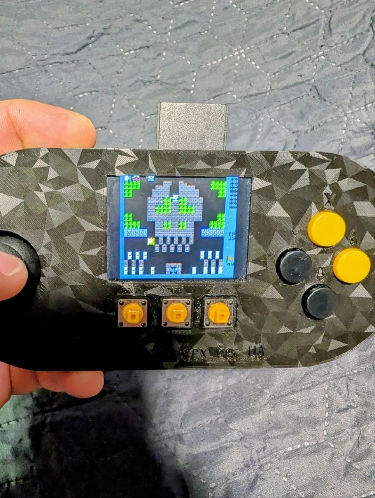
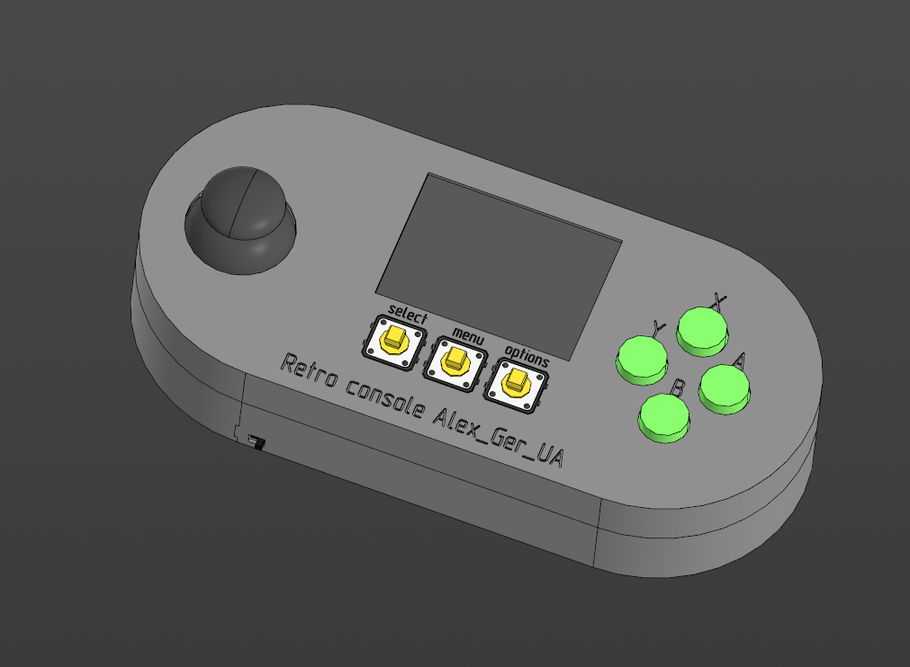
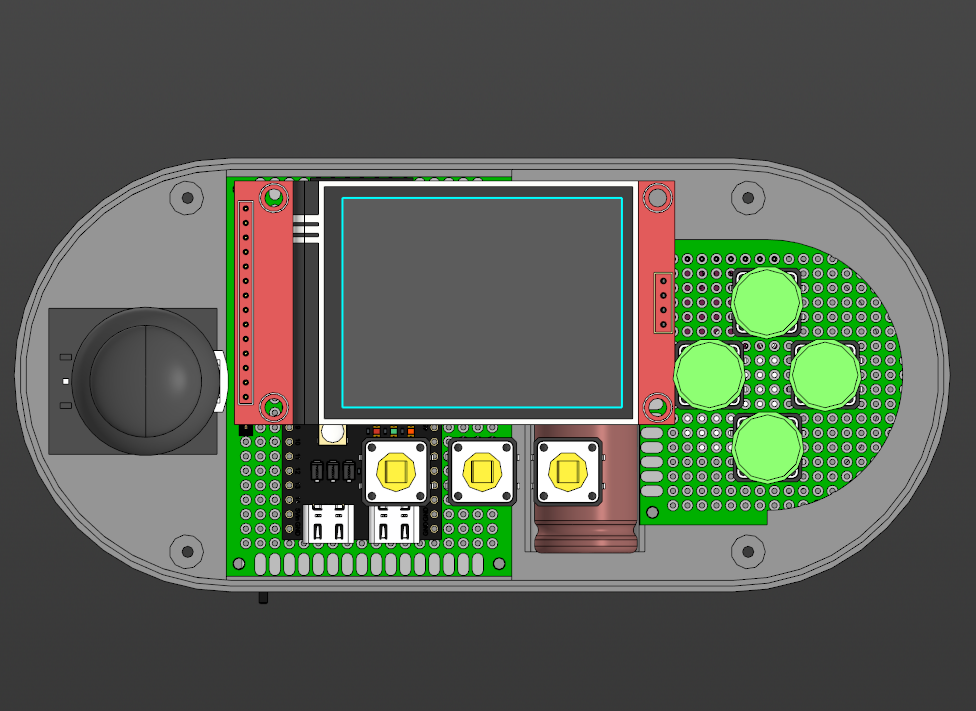
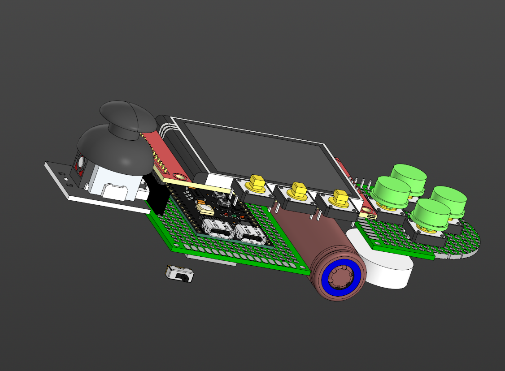
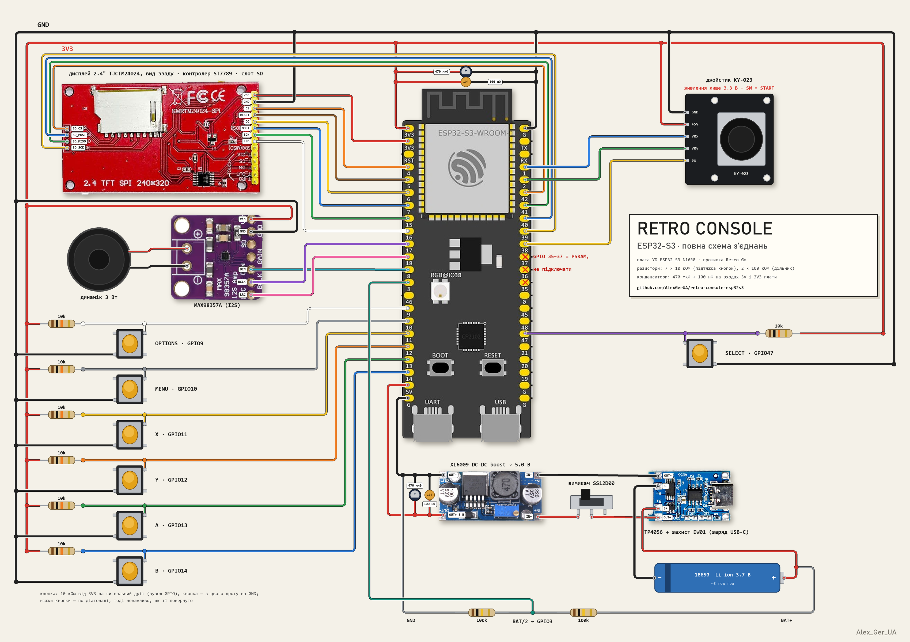

# Retro console on ESP32-S3

[English below](#english)

Портативна ретро-консоль на ESP32-S3 із запчастин приблизно на 800 грн: Dendy (NES),
Game Boy / Color, Sega Master System / Game Gear та інші системи з
[Retro-Go](https://github.com/ducalex/retro-go). Корпус надрукований на 3D-принтері,
живлення від 18650 (~8 годин гри).

<p align="center"></p>

| Зовні | Усередині | Як усе стоїть |
|---|---|---|
|  |  |  |

## Що вміє

- **Запускається все з `retro-core`**: NES/Dendy, Game Boy / Game Boy Color, Master System /
  Game Gear, PC Engine, Atari Lynx, Game & Watch, SNES. Найважчі ігри (частина SNES) не тягне.
- **Турбо-кнопки для Dendy**: X = автовогонь A, Y = автовогонь B (~15 Гц, як на старих джойстиках).
- **SNES на 8 фізичних кнопок**: власна розкладка «Type D» (L/R — MENU + Y/X).
- Звук через MAX98357A на динамік 3 Вт, збереження стану, екран 320×240.
- Ігри — з повнорозмірної SD-карти. ROM-и не постачаються: використовуйте власні копії.

**Не зроблено:** DOOM (`prboom-go`) і Mega Drive (`gwenesis`) з Retro-Go поки не зібрані під
цю плату. Хто перший запустить — тому респект і пул-реквест.

## Керування

| Кнопка | Дія |
|---|---|
| Джойстик | напрямки |
| Натиск джойстика | START |
| A / B | дії |
| X / Y | турбо A / B (Dendy), X/Y (SNES) |
| SELECT | SELECT |
| MENU | меню Retro-Go: збереження, завантаження, вихід |
| OPTIONS | налаштування емулятора |

## Залізо

| Компонент | Що шукати в магазині | К-сть | Ціна, грн |
|---|---|---|---|
| Плата | YD-ESP32-S3 **N16R8** (ESP32-S3-WROOM-1, 16 МБ flash, 8 МБ PSRAM) | 1 | 250 |
| Екран | 2.4" TFT SPI 240×320 зі слотом SD (TJCTM24024 / KMRTM24024-SPI) | 1 | 200 |
| Підсилювач | MAX98357A I2S 3 Вт | 1 | 60 |
| Динамік | 3 Вт | 1 | 50 |
| Джойстик | KY-023 | 1 | 100 разом із кнопками |
| Кнопки | тактові 12×12 мм | 7 | — |
| Акумулятор | 18650 Li-ion | 1 | — |
| Зарядка | TP4056 USB-C із захистом (DW01) | 1 | 40 |
| Перетворювач | XL6009 DC-DC boost, виставити 5.0 В | 1 | 60 |
| Вимикач | SS12D00 | 1 | — |
| Резистори | 10 кОм (підтяжка кнопок) | 7 | — |
| Резистори | 100 кОм (дільник батареї на GPIO3) | 2 | — |
| Конденсатори | електроліт 470 мкФ (входи 5V і 3V3 плати) | 2 | — |
| Конденсатори | кераміка 100 нФ (там само) | 2 | — |
| Монтаж | макетні плати, дроти | — | 50 |
| Карта пам'яті | SD, FAT32 | 1 | — |
| Корпус | друк PLA (підійде будь-який пластик), 4 гвинти | — | — |

**Разом ≈ 810 грн** + пластик, акумулятор і дрібниця (резистори, конденсатори, вимикач).
Посилань на магазини немає навмисно: вони швидко вмирають, а за назвами з таблиці все
знаходиться на AliExpress чи в будь-якому радіомагазині.

### Розпіновка



Джерело правди — [`config.h` таргета](firmware/retro-go-overlay/components/retro-go/targets/retro-console/config.h).
Кожна кнопка — на GND, з підтяжкою 10 кОм до 3V3 (дроти до кнопок довгі й ловлять
наводки; внутрішньої підтяжки замало).

#### Як підключати кнопки

```
3V3 ──[10 кОм]──┬────────────── GPIO
                │
              [кнопка]
                │
               GND
```

- Резистор 10 кОм іде від 3V3 **прямо на сигнальний дріт** — на той самий вузол, що
  йде на GPIO. Кнопка стоїть між цим дротом і GND.
- Не вішай резистор на одну ніжку кнопки, а GPIO — на іншу: тоді підтяжка доходить до
  GPIO лише через внутрішнє з'єднання кнопки, і все залежить від того, які ніжки в
  конкретної кнопки з'єднані між собою. Не вгадав — кнопка «натиснута» завжди або
  GPIO висить у повітрі.
- У тактової кнопки 12×12 чотири ніжки, попарно з'єднані всередині. Бери дві ніжки
  **по діагоналі** — така пара завжди розмикається кнопкою, хоч як її поверни.
  Сумніваєшся — продзвони мультиметром: ненатиснута кнопка — обрив, натиснута — 0 Ом.
- Натиснуто = GPIO читає 0, відпущено = 1.
На входах живлення плати (5V–G і 3V3–G) — по парі конденсаторів: електроліт 470 мкФ
і кераміка 100 нФ.

### Граблі, на які я вже наступив

- **Модуль екрана підписаний ILI9341, а контролер у ньому — ST7789.** Із драйвером ILI9341
  картинка зсунута й зі сміттям. Панель BGR і **без інверсії** (`MADCTL 0xA8`, `INVOFF`).
- **GPIO 33–37 на N16R8 зайняті octal PSRAM.** На гребінці вони виглядають вільними, але
  будь-яке використання вішає плату.
- **Джойстик — лише від 3.3 В.** Від 5 В центр стіка читається як натиснутий «вгору»,
  а на піни йде понад 3.6 В.
- **Скетч Arduino поверх Retro-Go ламає розмітку флешу**: перед поверненням до Retro-Go —
  `esptool.py erase_flash`.

## Корпус

STL у [`3d/`](3d): верхня кришка [`Cover.stl`](3d/Cover.stl) і нижня [`Back.stl`](3d/Back.stl).
Друкував PLA, підійде будь-який. Готовий профіль друку для Bambu Lab —
на [MakerWorld](https://makerworld.com/en/models/3585503-retro-console-esp32-s3-nes-game-boy-sega). Дві кришки на 4 гвинти, слот під SD і USB-C збоку,
вимикач знизу.

## Прошивка

Це **оверлей** до Retro-Go: кілька наших файлів, які накладаються на свіжий клон.

```powershell
# 1. Retro-Go
git clone --recursive https://github.com/ducalex/retro-go.git retro-go

# 2. Наш таргет поверх
cd firmware\retro-go-overlay
.\apply.ps1 -RetroGo ..\..\retro-go

# 3. ESP-IDF 5.3.x (6.0 не підходить: у ньому видалено esp_adc_cal)
. $env:IDF_PATH\export.ps1

# 4. Збірка й заливка
cd ..\..\retro-go
python rg_tool.py build-fw launcher retro-core --target=retro-console
python rg_tool.py --port=COMx install launcher retro-core --target=retro-console
```

`apply.ps1` копіює таргет `retro-console` і реєструє його в `components/retro-go/config.h`.
На Linux/macOS досить скопіювати теки `components/` і `retro-core/` поверх клону й додати
таргет у `config.h` вручну (два рядки, див. скрипт).

### Інструменти для перевірки заліза (Arduino)

- [`tools/tft_test`](tools/tft_test) — екран без Retro-Go;
- [`tools/button_map`](tools/button_map) — яка кнопка на якому GPIO;
- [`tools/joy_calib`](tools/joy_calib) — сирі значення джойстика для порогів.

## Ліцензія й подяки

GPL-2.0, як і [Retro-Go](https://github.com/ducalex/retro-go) (Alex Duchesne та автори
емуляторів). Корпус і схема — Alex_Ger_UA.

---

## English

A handheld retro console built from ~$20 of parts on an ESP32-S3: NES, Game Boy / Color,
Master System / Game Gear and the rest of [Retro-Go](https://github.com/ducalex/retro-go)'s
`retro-core`. 3D-printed case, 18650 battery (~8 h of play).

- Everything in `retro-core` boots; the heaviest titles (some SNES) are too slow.
- **NES turbo buttons**: X = turbo A, Y = turbo B. **SNES "Type D"** mapping uses all 8 buttons.
- Not done yet: DOOM (`prboom-go`) and Mega Drive (`gwenesis`). PRs welcome.
- Wiring: [`docs/pinout.png`](docs/pinout.png); pins live in the target's
  [`config.h`](firmware/retro-go-overlay/components/retro-go/targets/retro-console/config.h).
- Gotchas: the "ILI9341" display module is really an **ST7789** (BGR, no inversion);
  GPIO 33–37 are octal PSRAM on N16R8; power the joystick from 3.3 V only.
- Build: clone Retro-Go, run `firmware/retro-go-overlay/apply.ps1`, use ESP-IDF 5.3.x,
  `python rg_tool.py build-fw launcher retro-core --target=retro-console`.
- Case: [`3d/Cover.stl`](3d/Cover.stl), [`3d/Back.stl`](3d/Back.stl), PLA is fine; ready-to-print profile on
  [MakerWorld](https://makerworld.com/en/models/3585503-retro-console-esp32-s3-nes-game-boy-sega).

License: GPL-2.0 (same as Retro-Go). ROMs are not included — use your own dumps.
