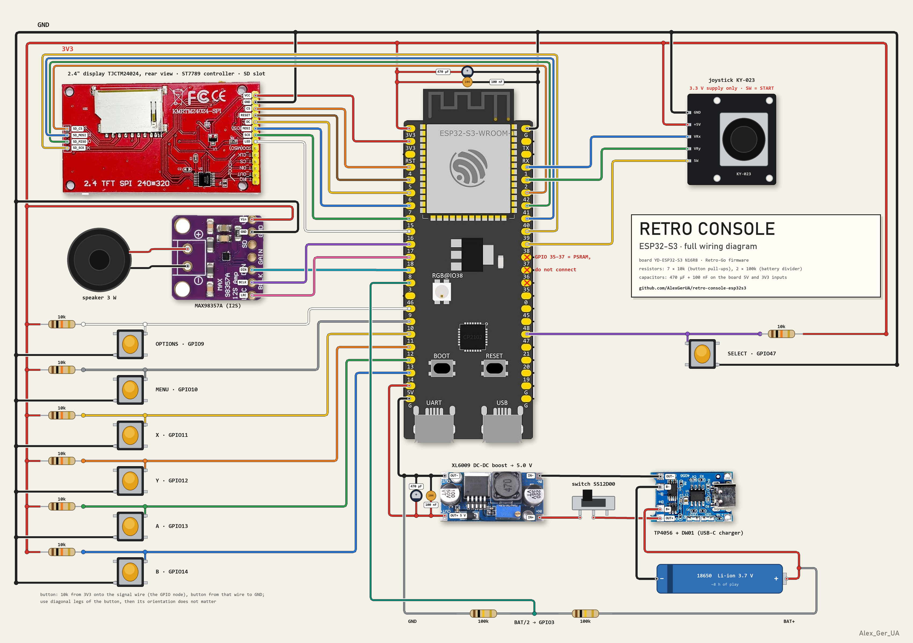

# Retro console on ESP32-S3

**English** | [Українська](README.uk.md)

A handheld retro console built on an ESP32-S3 from about $20 of parts: NES (Dendy),
Game Boy / Color, Sega Master System / Game Gear and other systems from
[Retro-Go](https://github.com/ducalex/retro-go). 3D-printed case, powered by an 18650
(~8 hours of play).

<p align="center"></p>

| Outside | Inside | How it fits together |
|---|---|---|
|  |  |  |

## Features

- **Everything in `retro-core` boots**: NES, Game Boy / Game Boy Color, Master System /
  Game Gear, PC Engine, Atari Lynx, Game & Watch, SNES. The heaviest games (some SNES) are too slow.
- **NES turbo buttons**: X = turbo A, Y = turbo B (~15 Hz, like old third-party pads).
- **SNES on 8 physical buttons**: custom "Type D" mapping (L/R = MENU + Y/X).
- Sound through a MAX98357A into a 3 W speaker, save states, 320×240 screen.
- Games load from a full-size SD card. No ROMs included: use your own dumps.

**Not done yet:** DOOM (`prboom-go`) and Mega Drive (`gwenesis`) from Retro-Go are not built
for this board yet. Whoever gets them running first — respect and a pull request.

## Controls

| Button | Action |
|---|---|
| Joystick | D-pad |
| Joystick press | START |
| A / B | actions |
| X / Y | turbo A / B (NES), X/Y (SNES) |
| SELECT | SELECT |
| MENU | Retro-Go menu: save, load, quit |
| OPTIONS | emulator settings |

## Hardware

| Part | What to search for | Qty | Price, UAH |
|---|---|---|---|
| Board | YD-ESP32-S3 **N16R8** (ESP32-S3-WROOM-1, 16 MB flash, 8 MB PSRAM) | 1 | 250 |
| Display | 2.4" TFT SPI 240×320 with SD slot (TJCTM24024 / KMRTM24024-SPI) | 1 | 200 |
| Amplifier | MAX98357A I2S 3 W | 1 | 60 |
| Speaker | 3 W | 1 | 50 |
| Joystick | KY-023 | 1 | 100 together with the buttons |
| Buttons | 12×12 mm tact switches | 7 | — |
| Battery | 18650 Li-ion | 1 | — |
| Charger | TP4056 USB-C with protection (DW01) | 1 | 40 |
| Converter | XL6009 DC-DC boost, set to 5.0 V | 1 | 60 |
| Power switch | SS12D00 | 1 | — |
| Resistors | 10 kΩ (button pull-ups) | 7 | — |
| Resistors | 100 kΩ (battery divider on GPIO3) | 2 | — |
| Capacitors | 470 µF electrolytic (board 5V and 3V3 inputs) | 2 | — |
| Capacitors | 100 nF ceramic (same place) | 2 | — |
| Assembly | perfboards, wires | — | 50 |
| Memory card | SD, FAT32 | 1 | — |
| Case | PLA print (any plastic will do), 4 screws | — | — |

**Total ≈ 810 UAH (~$20)** plus plastic, the battery and small parts (resistors, capacitors,
switch). No shop links on purpose: they die fast, and every part is easy to find on
AliExpress or in any electronics shop by the names in the table.

### Pinout



Source of truth — the target's [`config.h`](firmware/retro-go-overlay/components/retro-go/targets/retro-console/config.h).
Every button goes to GND with a 10 kΩ pull-up to 3V3 (the wires to the buttons are long and
pick up noise; the internal pull-up is too weak).

#### How to wire the buttons

```
3V3 ──[10 kΩ]──┬────────────── GPIO
               │
            [button]
               │
              GND
```

- The 10 kΩ resistor goes from 3V3 **straight onto the signal wire** — the same node that
  runs to the GPIO. The button sits between that wire and GND.
- Don't put the resistor on one leg of the button and the GPIO on another: then the pull-up
  reaches the GPIO only through the button's internal connection, and everything depends on
  which legs of that particular button are joined inside. Guess wrong — the button reads
  "pressed" forever, or the GPIO floats.
- A 12×12 tact switch has four legs, joined in pairs inside. Use two legs **on a diagonal** —
  that pair is always switched by the button, whichever way you turn it.
  Not sure — check with a multimeter: released = open, pressed = 0 Ω.
- Pressed = GPIO reads 0, released = 1.

On the board's power inputs (5V–G and 3V3–G) there is a pair of capacitors each: a 470 µF
electrolytic and a 100 nF ceramic.

### Gotchas I've already stepped on

- **The display module is labelled ILI9341, but the controller inside is an ST7789.** With the
  ILI9341 driver the picture is shifted and full of garbage. The panel is BGR and **not
  inverted** (`MADCTL 0xA8`, `INVOFF`).
- **GPIO 33–37 on the N16R8 are taken by the octal PSRAM.** On the header they look free, but
  using any of them hangs the board.
- **Power the joystick from 3.3 V only.** From 5 V the stick's centre reads as "up" pressed,
  and the pins get more than 3.6 V.
- **An Arduino sketch flashed over Retro-Go breaks the flash layout**: before going back to
  Retro-Go run `esptool.py erase_flash`.

## Case

STL files are in [`3d/`](3d): the top cover [`Cover.stl`](3d/Cover.stl) and the bottom
[`Back.stl`](3d/Back.stl). Printed in PLA, anything will do. A ready-made Bambu Lab print
profile is on [MakerWorld](https://makerworld.com/en/models/3585503-retro-console-esp32-s3-nes-game-boy-sega).
Two shells held by 4 screws, SD and USB-C slots on the side, power switch at the bottom.

## Firmware

This is an **overlay** for Retro-Go: a few of our files laid over a fresh clone.

```powershell
# 1. Retro-Go
git clone --recursive https://github.com/ducalex/retro-go.git retro-go

# 2. Our target on top
cd firmware\retro-go-overlay
.\apply.ps1 -RetroGo ..\..\retro-go

# 3. ESP-IDF 5.3.x (6.0 won't do: esp_adc_cal was removed there)
. $env:IDF_PATH\export.ps1

# 4. Build and flash
cd ..\..\retro-go
python rg_tool.py build-fw launcher retro-core --target=retro-console
python rg_tool.py --port=COMx install launcher retro-core --target=retro-console
```

`apply.ps1` copies the `retro-console` target and registers it in `components/retro-go/config.h`.
On Linux/macOS just copy the `components/` and `retro-core/` folders over the clone and add the
target to `config.h` by hand (two lines, see the script).

### Hardware test tools (Arduino)

- [`tools/tft_test`](tools/tft_test) — the display without Retro-Go;
- [`tools/button_map`](tools/button_map) — which button is on which GPIO;
- [`tools/joy_calib`](tools/joy_calib) — raw joystick values for the thresholds.

## License and credits

GPL-2.0, same as [Retro-Go](https://github.com/ducalex/retro-go) (Alex Duchesne and the
emulator authors). Case and wiring diagram — Alex_Ger_UA.
